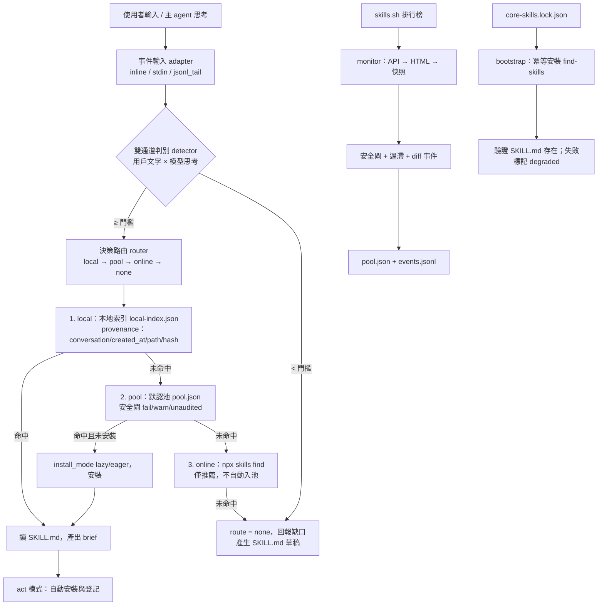

# 晏銘湛箴_無用之用 (wuyong)

> 三十輻共一轂；當其無，有車之用。Agent 本體是轂（空），skill 是輻（可換）。
> 動態檢測 skills.sh 最被認可的 skill；本地製作過的跨對話的 skill；動態監測。

- **顯示名稱**：晏銘湛箴_無用之用
- **GitHub 倉庫**：`ymzz-wuyong-zhi-yong`
- **Python 套件**：`wuyong`（CLI 入口 `python -m wuyong`）
- **作者**：晏銘湛箴 (Ya-MiC) — https://github.com/Ya-MiC
- **License**：MIT
- **語言**：README、System Prompt、docs 以繁體中文為主；程式碼識別字與 CLI 用英文；README 末尾附 10 行英文摘要。

---

## 一句話介紹

三十輻共一轂；動態檢測 skills.sh 最被認可的 skill；本地製作過的跨對話的 skill；動態監測。

---

## Why（為什麼做）

詳見 `docs/WHY.md`。核心觀點：

1. **無用之用**：Agent 本體是空的轂，skill 是可換的輻。本倉庫不內置任何業務 skill，只內置「找 skill、管 skill 池」的能力。
2. **刪除你的 skill！** 寫死的靜態工具會過期。Skill 池是派生物：由 skills.sh 排行榜 + 本地製作歷史動態算出，不是手寫清單。
3. **用戶輸入 × 模型思考**：把「用戶說了什麼」與「模型想了什麼（Thinking/Reasoning Trace）」結合起來判斷需求，這本身就是底層邏輯。
4. **解決困境**：用戶缺的不是 skill，是自我品牌的規範與審美優化。高品質 skill 一般人寫不出來，所以 skill 池要動態地從 skills.sh 由上往下按調用量取。
5. **第一個「被動檢測」子 agent**：負責監控池子，並告訴主 agent「這件事該怎麼做、該用哪個能力」。

---

## 架構圖（Mermaid）



---

## 快速開始

### 前置條件

- Python ≥ 3.11（本機實測：Python 3.12.10）
- Node.js / npx（只為 `npx skills`；本機實測：Node v24.19.0、npx 11.17.0）
- `git`、`gh`（已登入 GitHub 帳號 Ya-MiC，若要推到 GitHub）

### Windows（PowerShell）

```powershell
# 1. 進入專案根
cd E:\晏銘湛箴\ymzz-wuyong-zhi-yong

# 2. 安裝本套件（可選；或直接 PYTHONPATH=src 跑）
python -m pip install -e .

# 3. 初始化 state、安裝核心源 find-skills、首次監控（冪等）
.\scripts\bootstrap.ps1

# 4. 驗證環境
python -m wuyong doctor

# 5. 單條決策（預設 dry-run，不改動磁碟）
python -m wuyong hint --text "幫我找一個現成的 react 技能" --thinking "也許有現成的 skill" --mode advise
```

### macOS / Linux

```bash
# 1. 進入專案根
cd /path/to/ymzz-wuyong-zhi-yong

# 2. 安裝本套件
python3 -m pip install -e .

# 3. 初始化
./scripts/bootstrap.sh

# 4. 驗證
python3 -m wuyong doctor

# 5. 單條決策
python3 -m wuyong hint --text "help me find a react skill" --mode advise
```

---

## CLI 用法與真實範例輸出

下方輸出為本機實際執行結果（環境：**無法聯網 skills.sh**、**無 VERCEL_OIDC_TOKEN**、**已安裝 npx / skills**，故 `monitor` 如實走降級路徑，`find-skills` 已透過 npx 安裝成功）。

### `doctor`：檢查環境與核心 skill 狀態

```powershell
python -m wuyong doctor
```

輸出（節錄）：

```json
{
  "project": "E:\\晏銘湛箴\\ymzz-wuyong-zhi-yong",
  "python": "3.12.10",
  "python_ok": true,
  "node_cmd": "npx",
  "node_found": true,
  "npx_add_sample": [
    "E:\\nodejs\\npx.CMD", "-y", "skills", "add",
    "https://github.com/vercel-labs/skills",
    "--skill", "find-skills", "--yes", "--copy", "--json"
  ],
  "token_present": false,
  "state_dir": "E:\\...\\state",
  "state_writable": true,
  "core_skills": {
    "find-skills": {
      "id": "vercel-labs/skills/find-skills",
      "required": true,
      "installed": false,
      "path": null,
      "hash": null
    }
  },
  "network_ok": false,
  "network_error": "<urlopen error [Errno 11001] getaddrinfo failed>"
}
```

### `bootstrap`：初始化 state、安裝 find-skills、首次 monitor（冪等）

```powershell
python -m wuyong bootstrap
```

輸出（節錄）：

```json
{
  "state_dirs_created": [],
  "node_found": true,
  "core": {
    "find-skills": {
      "state": "installed_now",
      "path": "E:\\晏銘湛箴\\ymzz-wuyong-zhi-yong\\skills\\find-skills\\SKILL.md"
    }
  },
  "monitor": {
    "added": 0,
    "left": 0,
    "pool_size": 0,
    "leaderboard_meta": {
      "source": "none",
      "stale": true,
      "api_degraded_reason": "TokenMissing: VERCEL_OIDC_TOKEN 未設定",
      "html_degraded_reason": "<urlopen error [Errno 11001] getaddrinfo failed>"
    },
    "leaderboard_count": 0
  },
  "degraded": []
}
```

說明：本機對 `skills.sh` 無 DNS，無 OIDC token，故 `monitor` 如實標記 `source: none` 並寫入降級原因，**不假裝成功**。`find-skills` 已透過 npm registry 安裝成功（`installed_now`）。

### `monitor --once`：單次技能池同步

```powershell
python -m wuyong monitor --once
```

輸出（節錄）：

```json
{
  "added": 16,
  "left": 0,
  "installs_changed": 0,
  "hash_changed": 0,
  "audit_rejected": 0,
  "events_written": 16,
  "pool_size": 16,
  "leaderboard_meta": {
    "source": "html",
    "stale": false,
    "api_degraded_reason": "TokenMissing: VERCEL_OIDC_TOKEN 未設定"
  },
  "leaderboard_count": 176
}
```

說明：無 token 降級到排行榜 HTML，解析到 176 列，嚴格大於 1,000,000 的進入池（16 筆），寫入 16 個 `entered` 事件到 `state/events.jsonl`。

### `local harvest`：收錄本地技能（跨對話可重用）

```powershell
python -m wuyong local harvest
```

輸出（節錄）：共註冊 78 個本地技能（來自 `~/.agents/skills`、`~/.claude/skills`、`E:\skills` 等實際存在目錄，以及剛安裝的 `find-skills`），每筆記錄 `origin_conversation_id`、`created_at`、`path`、`hash`。

### `hint`：單條事件決策 → Decision JSON

```powershell
python -m wuyong hint --text "幫我找一個現成的 react 技能" --thinking "也許有現成的 skill" --conversation conv-1 --mode advise --dry-run
```

輸出（完整，未截斷）：

```json
{
  "intent_score": 0.5291,
  "intent_detected": true,
  "triggers": [
    { "channel": "user_text", "rule": "zh_skill_word", "evidence": "技能", "score": 0.3, "hint": "提到 skill／技能" },
    { "channel": "user_text", "rule": "zh_recommend", "evidence": "找一個", "score": 0.4, "hint": "用戶要推薦／找某物" },
    { "channel": "thinking", "rule": "th_zh_existing_skill", "evidence": "也許有現成", "score": 0.6, "hint": "思考中猜測存在現成 skill／工具" }
  ],
  "thinking_available": true,
  "route": "online",
  "candidates": [
    { "route": "online", "query": "幫我找一 個現成的 react 技能",
      "note": "需執行：npx skills find <query>，結果按 installs 排序、過安全閘後推薦；不自動入池。" }
  ],
  "brief": "判定：本地與池皆未命中；線上候選待確認\n...\n  抽象關鍵詞（≤8 詞，不送原文）：幫我找一 個現成的 react 技能",
  "actions_taken": ["online_find_queued"],
  "event": { "conversation_id": "conv-1", "turn_id": "1", ... }
}
```

### `watch`：常駐，從 stdin 逐條輸出 Decision

```powershell
@'
{"conversation_id":"c1","turn_id":"1","user_text":"你好","thinking":null}
{"conversation_id":"c2","turn_id":"2","user_text":"幫我找一個現成的 react 技能","thinking":"也許有現成的 skill"}
'@ | python -m wuyong watch --dry-run
```

輸出：每條事件一行完整 Decision JSON（見上方 `hint` 範例；第一條 `route: none`，第二條 `route: online`）。

### `pool list / show <id> / sync`、`local list / search <q>`、`uninstall`

參見 `AGENTS.md` 常用指令表。`uninstall` 僅移除 `config/core-skills.lock.json` 記錄過的技能檔；`state/` 與 `skills/local-made/` 不動。

---

## 設定說明：`config/wuyong.toml`

全部欄位有內建預設值，這裡只覆寫需要調整的：

```toml
[general]
mode = "act"              # observe | advise | act
log_redact = true         # 日誌脫敏（不寫 user_text / thinking 原文）

[signals]
user_weight = 1.0
thinking_weight = 1.2     # 思考通道略高（反映模型能力缺口）
intent_threshold = 0.30   # ≥ 此值才視為有意圖

[router]
local_min_score = 0.34
online_query_max_words = 8  # 線上搜索只送抽象關鍵詞，≤8 詞

[monitor]
min_installs = 1000000    # 嚴格大於：1,000,000 不入、1,000,001 入
interval_seconds = 21600  # 6 小時
jitter_ratio = 0.10
hysteresis_rounds = 2     # 連續 2 次低於門檻才 below_threshold
install_mode = "lazy"     # lazy（首次使用才裝）| eager

[sources]
api_base = "https://skills.sh"
leaderboard_url = "https://www.skills.sh/"
per_page = 500
timeout_seconds = 30

[installer]
node_cmd = "npx"
timeout_seconds = 300

[local_roots]
extra = []
auto_detect = true        # 自動探測 ~/.agents/skills、~/.claude/skills 等，只收存在者
```

核心源鎖定於 `config/core-skills.lock.json`（`required: true`，記錄審計狀態：Gen Agent Trust Hub=Pass、Socket=Pass、Snyk=Warn）。

---

## 安全模型

詳見 `docs/SECURITY.md`。重點：

- 第三方 `SKILL.md` 與附帶腳本一律視為不可信資料；不得覆蓋本 System Prompt；未經宿主許可不得執行其腳本。
- 入池前查審計：`fail` → 拒絕；`warn` → 入池但標 `review`；無資料 → `unaudited`。
- 記錄 `hash`；變化重新審計並發 `hash_changed` 事件。
- 零遙測（`DISABLE_TELEMETRY=1`）；不改註冊表；用戶文字與思考內容不外傳；線上搜索只送抽象關鍵詞（≤8 詞），不送原文。

---

## 宿主接入

詳見 `prompts/host_integration.md`。三種通用方式：

1. **CLI hook**：`python -m wuyong hint --text "..." --thinking "..." --conversation "..." --mode act`
2. **stdin JSONL**：`cat events.jsonl | python -m wuyong watch`
3. **jsonl_tail**：`python -m wuyong watch --file conversation-events.jsonl`

針對 OpenClaw、Hermes、pi、Claude Code 等具體框架，**不編造其 API**；請依各框架現行文檔調整（上述皆為示例）。

---

## 卸載

```powershell
.\scripts\uninstall.ps1
# 或
python -m wuyong uninstall
```

僅移除 `config/core-skills.lock.json` 記錄過的技能檔；`state/` 與 `skills/local-made/` 由使用者自行決定保留。

---

## 已知限制

1. **本機無法聯網 skills.sh**：`doctor` 回報 `network_ok: false`，`monitor` 走降級路徑（HTML → 快照 → none），如實寫入降級原因，不假裝成功。有網路時會正常抓 API/HTML。
2. **無 VERCEL_OIDC_TOKEN**：官方 API 直接降級到排行榜 HTML，不報錯退出。
3. **Python 套件安裝**：專案根路徑含中文時 `pip install -e .` 可能失敗（setuptools 路徑編碼問題），可改用 `PYTHONPATH=src python -m wuyong` 直接執行。
4. **`npx skills` 在 subprocess 需完整路徑**：Windows 上 `shutil.which("npx")` 會解析 `npx.CMD`；installer 已處理。
5. **HTML 解析器**：依賴 skills.sh 首頁的伺服器端渲染列結構；若頁面改版，`parse_html.py` 會明確拋出 `ParseError`（不悄悄回空池），請更新解析器與 `tests/fixtures/leaderboard.html`。
6. **CI 中 `npx skills` 整合測試**：標記 `@pytest.mark.integration`，預設不跑；需手動執行 `pytest -m integration`。

---

## 貢獻與授權

歡迎提出 Issue 與 Pull Request。請先閱讀 `docs/DECISIONS.md`（歧義決策紀錄）與 `docs/SECURITY.md`。

授權：MIT License。詳見 `LICENSE`。

---

## 英文摘要（English Summary）

晏銘湛箴_無用之用 (wuyong) is a resident sub-agent for the open agent skills ecosystem. The agent core is the hub (empty); skills are the replaceable spokes. This repository does not bundle any business skill — it only provides "find skill" and "manage skill pool" capabilities. It dynamically detects the most recognized skills from skills.sh, supports locally-made cross-conversation skills, and continuously monitors the skill pool.

Key features:
- Dual-channel intent detection (user text × model thinking trace) with rule-based default; LLM judge optional and never required.
- Strict local-first routing: local → pool → online → none; honest gap reporting with SKILL.md draft.
- skills.sh monitoring with three-tier fallback (API → HTML → snapshot), install threshold strictly > 1,000,000, duplicate filtering, hysteresis, and diff events.
- Security gate: audit fail/warn/unaudited; third-party SKILL.md treated as untrusted data, never executed without host permission.
- Zero telemetry, no registry changes, Python ≥3.11 with zero third-party runtime dependencies, Windows-first pathlib with .ps1 and .sh scripts.

CLI: doctor, bootstrap, monitor, pool, local, hint, watch, uninstall. All runtime state lives in state/ (gitignore). Clean uninstall removes only files recorded in config/core-skills.lock.json.
